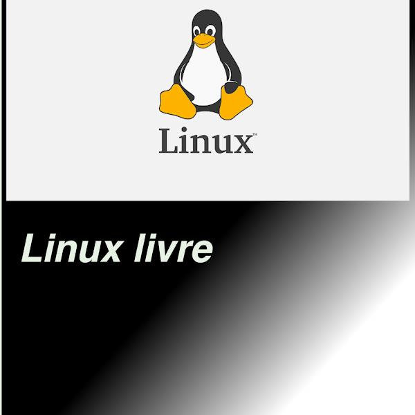

# Hyprbar



Fork independente baseado no código-fonte do **Noctalia v5.2.1**: um shell de desktop nativo para Wayland, com barra, widgets, dock, launcher, notificações, controles de sessão e seletor de papéis de parede. O Hyprbar é mantido por `tiaoedi` e não é endossado pelos mantenedores originais.

- Desenvolvedor: `sebastao .o santana` (GitHub: [@tiaoedi](https://github.com/tiaoedi))
- YouTube: [Linux Livre](https://www.youtube.com/@linuxlivre9008)

## Baixar e instalar

O GitHub oferece arquivos ZIP/TAR do código-fonte; consulte [Releases](https://github.com/tiaoedi/hyprbar/releases) para pacotes binários quando houver uma versão publicada. Não há RPM nem checksum de release publicados ainda. Para compilar no Fedora, siga [`INSTALACAO-PT-BR.md`](INSTALACAO-PT-BR.md) e [`BUILDING.md`](BUILDING.md).

Para iniciar automaticamente no Hyprland, adicione `exec-once = hyprbar --daemon` à configuração do compositor. No Niri, consulte [`docs/user/compositor-settings/niri.mdx`](docs/user/compositor-settings/niri.mdx). A documentação complementar está em [`docs/user/getting-started/installation.mdx`](docs/user/getting-started/installation.mdx).

## Compatibilidade verificada

| Ambiente | Verificação deste fork |
|---|---|
| Fedora 44 x86_64 | Compilação do código-fonte e suíte de testes verificados; RPM ainda não publicado |
| Hyprland 0.56.2 | Execução e painéis principais verificados |
| Niri | Configuração de inicialização validada; execução não verificada |
| Outros compositores/distribuições | Não verificados |

É necessário iniciar em uma sessão Wayland com suporte EGL/GLES. Áudio depende de PipeWire/WirePlumber; recursos opcionais podem depender de serviços disponíveis na sessão. A compatibilidade efetiva varia conforme os protocolos e recursos oferecidos pelo compositor.

## Integrações externas

O Hyprbar usa integrações externas para alguns recursos opcionais, como catálogos de paletas e templates, localização, consulta de IP público e OAuth do Google Calendar. A telemetria é opt-in (`telemetry_enabled = false` por padrão). Os serviços externos, seus operadores e o tratamento dos dados não são verificados por este repositório; consulte [`NETWORK-PRIVACY.md`](NETWORK-PRIVACY.md) para os endpoints e detalhes técnicos. Nenhuma política externa é apresentada como política do Hyprbar. `offline_mode = true` bloqueia novos pedidos pelo cliente HTTP compartilhado do Hyprbar, mas não cancela transferências já em andamento e não é firewall: navegador, outros processos e caminhos arbitrários de plugins podem continuar usando a rede. Caches locais ainda podem ser lidos. Veja `NETWORK-PRIVACY.md` e a documentação de [localização](docs/user/services/location.mdx), [calendário](docs/user/services/calendar.mdx) e [configuração](docs/user/configuration/shell.mdx).

## Compilar do código-fonte

Consulte [`BUILDING.md`](BUILDING.md) para dependências e instruções por distribuição. Exemplo:

```sh
git clone --depth 1 https://github.com/tiaoedi/hyprbar.git
cd hyprbar
just configure release
just build release
sudo just install release
```

Para migrar uma configuração existente, consulte a ajuda do importador de compatibilidade antes de aplicar qualquer cópia. Alguns identificadores históricos de configuração, plugins e integrações são mantidos para compatibilidade; a identidade, os caminhos novos e o desenvolvimento do projeto são próprios do Hyprbar.

## Sobre o Hyprbar

Abra **Configurações → Sobre** para ver a versão instalada, o desenvolvedor e os links do GitHub e do canal Linux Livre. Também é possível abrir a seção com `hyprbar msg settings-open about`.

O logo fornecido pelo mantenedor (`capa-canal.jpg`) está incorporado em `assets/hyprbar.svg`, sem depender de um caminho pessoal. O mesmo asset é usado pelo ícone do aplicativo, pela seção Sobre e pelo logo padrão da Central de Controle; um `custom_image` configurado continua tendo prioridade.

## Créditos e licença

O histórico do código-fonte e os créditos de origem estão em [`CREDITS.md`](CREDITS.md). A licença principal é MIT; componentes incluídos em `third_party/` e a fonte Tabler mantêm suas próprias licenças. Consulte [`LICENSE`](LICENSE) e os avisos de cada componente antes de redistribuir.
